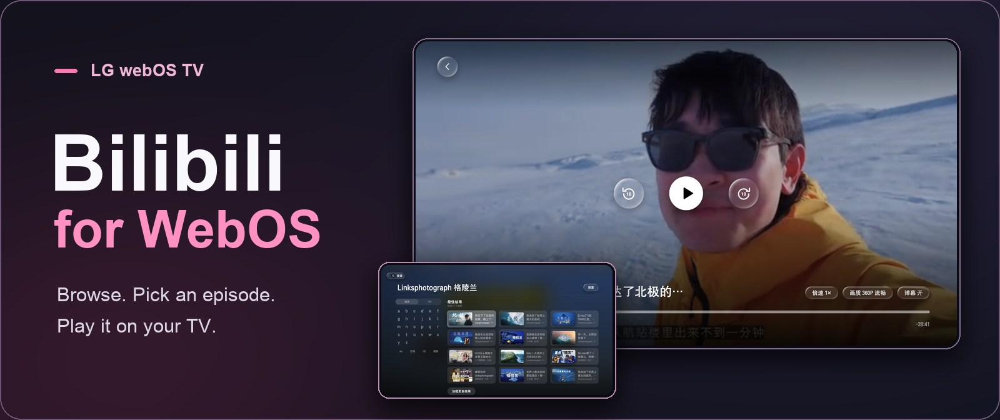
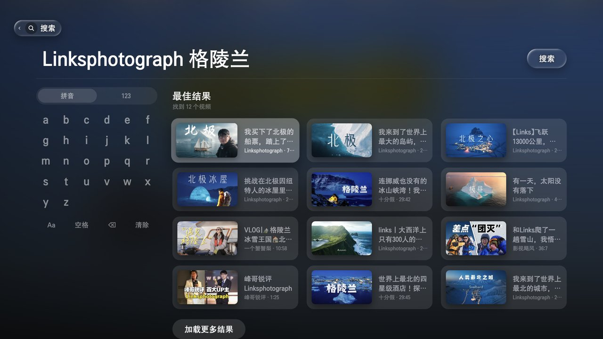

  

  
  
  
  

  <strong>用遥控器在 LG 电视上逛 B 站、选集和看视频。</strong> 
  从推荐和搜索找到想看的内容，扫码后也能接着看自己的关注、历史和收藏。

  <a href="https://github.com/jmxin7g/bilibili-for-webos/releases/latest"><strong>下载标准版</strong></a> ·
  <a href="#安装到电视"><strong>安装到电视</strong></a> ·
  <a href="#认识-bilibili-for-webos">功能介绍</a> ·
  <a href="#界面预览">界面预览</a> ·
  <a href="docs/BUILD.md">开发与构建</a>

## 认识 Bilibili for WebOS

Bilibili for WebOS 是一个面向 **LG webOS 电视**的第三方哔哩哔哩客户端。首页、侧栏、选集和播放控制都能用遥控器操作。配对安装后，应用连同播放服务运行在电视上，日常观看时可以关掉电脑。

### 浏览推荐、搜索视频、打开 UP 主主页

- 在首页看推荐和热门，也能按分区浏览。首页的 **继续观看** 会显示这台电视上尚未看完的视频。
- 在 **搜索** 页用屏幕键盘输入关键词或 BV 号，也可用剧集链接、`ss` / `ep` 编号找剧集。
- 视频详情页集中展示简介、相关推荐和 UP 主入口。从 UP 主主页可以浏览投稿。登录后还可以把想看的视频加入「稍后再看」。

### 选集、调画质、接着上次看

- 普通多 P 视频或剧集的详情页，播放按钮旁会出现 **选集**。选好一集就能直接播放。
- 在播放器里选择 **自动画质**，或手动选片源提供的档位。还可以调节倍速、开关弹幕，并在片源提供字幕时选择字幕。
- 应用会在电视本机保存观看进度，下次打开可继续。播放时按 **确认键** 呼出控制栏，控制栏收起时按左右键可以后退或前进 **10 秒**。

## 界面预览

<table>
  <tr>
    <td width="50%" align="center"> <strong>用遥控器搜索</strong></td>
    <td width="50%" align="center"> <strong>在详情页选视频</strong></td>
  </tr>
</table>

## 安装到电视

**第一次安装，选标准版。** 如果电视已经装过本项目的标准版，继续下载同一版本渠道的 IPK，即可覆盖更新。

1. **下载 IPK。** 打开 [最新标准版](https://github.com/jmxin7g/bilibili-for-webos/releases/latest)，在 **Assets** 下载名称以 `com.jinmx.independent.playback` 开头的 `.ipk` 文件。
2. **配对电视。** 在 LG 电视安装并开启 **Developer Mode**。电脑和电视连到同一网络后，用 [webOS Dev Manager](https://github.com/webosbrew/dev-manager-desktop/releases/latest) 添加电视。
3. **安装并打开。** 在 Dev Manager 中选择电视，进入 **Apps → Installed → Install**，选择刚下载的 IPK。之后从电视主页打开 **bilibili**。

[查看图文安装指南](docs/INSTALL.md)

> **Homebrew 版** 与标准版使用不同的应用 ID，可以同时安装，首次使用需要重新扫码。[下载 Homebrew 版](https://github.com/jmxin7g/bilibili-for-webos/releases/tag/homebrew-v1.0.3) · [社区目录进度](https://github.com/webosbrew/apps-repo/issues/385)

## 隐私与账号

- **登录信息只留在电视上。** 扫码后，登录 Cookie 由应用自带的服务保存在电视本机，不会上传到本项目或其他第三方服务器。
- **只连接哔哩哔哩。** 应用直接访问哔哩哔哩的接口和视频 CDN，不经过中转服务器。
- **观看进度存在本机。** 首页「继续观看」使用电视本地记录；登录后的观看历史、收藏等来自你的哔哩哔哩账号。
- **随时退出。** 在 **设置** 中选择 **退出当前账号**，会删除这台电视上保存的该账号登录信息。

## 兼容性与反馈

Homebrew v1.0.3 已在 **LG G6（webOS TV 26）** 验证启动、首页加载、游客模式 480p 播放和二维码显示。其他机型和画质的表现取决于片源、账号及电视解码能力。

遇到问题请[提交问题反馈](https://github.com/jmxin7g/bilibili-for-webos/issues/new/choose)，表单会提示你填写电视型号、webOS 版本、应用版本和复现步骤。

## 从源码构建

[浏览源码与目录说明](source/) · [构建命令与版本源码下载](docs/BUILD.md)

本项目由独立开发者维护，以 [MIT 许可证](LICENSE)开源。Bilibili 和 LG 的名称与标识归各自权利人所有，不在该许可范围内。
