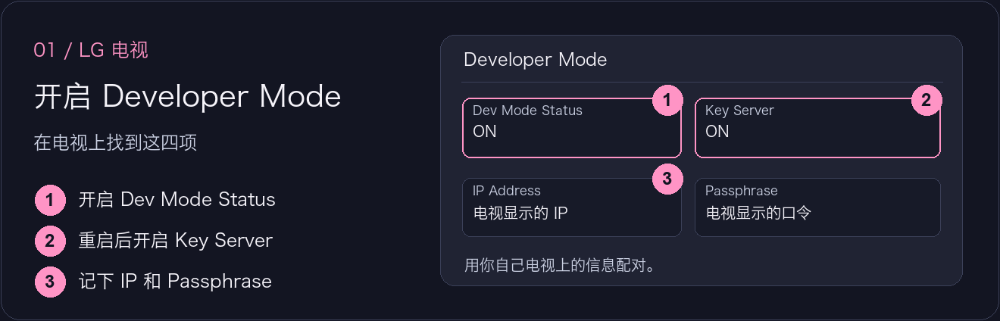

# LG 电视图文安装指南

[返回项目首页](../README.md) · [标准版下载](https://github.com/jmxin7g/bilibili-for-webos/releases/latest) · [Homebrew 版下载](https://github.com/jmxin7g/bilibili-for-webos/releases/tag/homebrew-v1.0.3)

开始前，请把电脑和 LG 电视连到**同一个局域网**，并在电脑安装 [webOS Dev Manager](https://github.com/webosbrew/dev-manager-desktop/releases/latest)。电脑端配图为 Dev Manager 实际截图。

## 先下载 IPK

打开对应的发布页，在 **Assets** 里下载 `.ipk` 文件。

| 你想安装的版本 | 安装包文件名开头 |
| --- | --- |
| **标准版**，适合第一次安装或覆盖更新标准版 | `com.jinmx.independent.playback_` |
| **Homebrew 版**，适合并行试用或覆盖更新 Homebrew 版 | `io.github.jmxin7g.bilibili_` |

## 1. 在电视开启 Developer Mode



1. 在 LG 电视的应用商店搜索并安装 **Developer Mode**，打开后用 LG Developer 账号登录。
2. 把 **Dev Mode Status** 切到 **ON**，按提示重启电视。
3. 重启后再次打开 **Developer Mode**，确认 **Dev Mode Status** 仍然开启。打开 **Key Server**，记下电视 IP 和 **Passphrase**。

[查看 LG 官方电视界面截图和配对说明](https://webostv.developer.lge.com/develop/getting-started/developer-mode-app)

## 2. 在电脑上配对电视

1. 打开 **webOS Dev Manager**，进入左下角 **Settings → Devices → Add new device…**。选择 **Use Developer Mode**，点击 **Next**。

<details>
<summary>查看实际的 Connection Mode 界面</summary>


</details>

2. 到 **Setup Device** 页面后，在 **Address** 填写你自己电视的 IP，在 **Dev Mode passphrase** 填写电视上显示的口令，注意大小写。用户名 **prisoner** 和端口 **9922** 保持默认。
3. 点击右下角 **Finish**。配对成功后，可以在 Dev Manager 的设备菜单里选到这台电视。


## 3. 安装 IPK 并启动

1. 在 Dev Manager 选择电视，进入左侧 **Apps**，切到 **Installed**。
2. 点右上角 **Install**，在文件选择窗口选中已下载的 `.ipk`，点击 **打开**。
3. 等应用出现在 **Installed** 列表里，再到电视主页打开 **bilibili**。截图里并行安装了两个版本，你只需要安装一个。


## 4. 第一次使用

打开侧栏，进入 **设置 → 扫码登录**，用手机哔哩哔哩 App 扫描电视上的二维码，并在手机上确认。

两个版本可以同时安装，各自保存登录状态。更新时请选择相同应用 ID 的新版 IPK。要延长 Developer Mode，请在 **Remain Session** 归零前打开 Developer Mode 并点击 **EXTEND**。

## 命令行安装

<details>
<summary>展开 webOS CLI 配对和安装命令</summary>

在电脑安装 LG 的 webOS CLI。运行 `ares-setup-device` 添加电视。以下以设备名 `my-tv` 为例，端口为 `9922`，SSH 用户为 `prisoner`。

在电视的 **Developer Mode** 里打开 **Key Server**。然后在电脑终端获取配对密钥，按提示输入电视显示的 Passphrase。

```sh
ares-novacom --device my-tv --getkey
```

进入存放 IPK 的目录，选择下面一组命令。请用实际设备名和安装包文件名。

**标准版**

```sh
ares-install -d my-tv com.jinmx.independent.playback_1.0.3_all.ipk
ares-launch -d my-tv com.jinmx.independent.playback
```

**Homebrew 版**

```sh
ares-install -d my-tv io.github.jmxin7g.bilibili_1.0.3_all.ipk
ares-launch -d my-tv io.github.jmxin7g.bilibili
```

</details>
